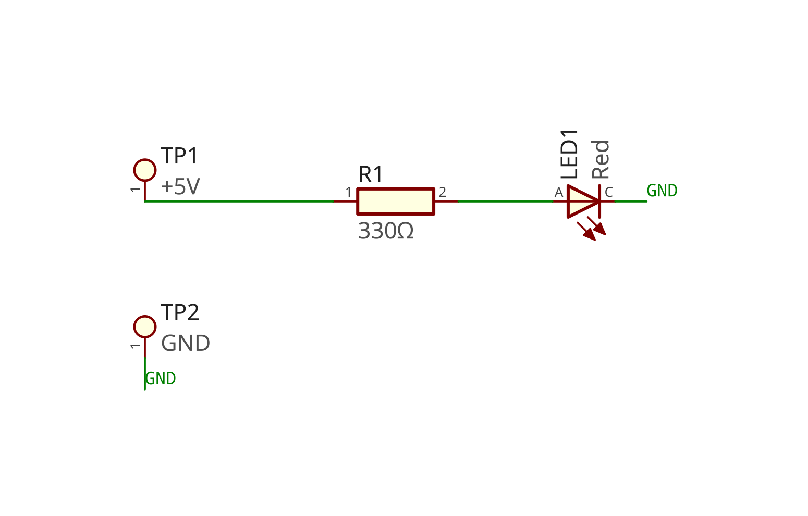
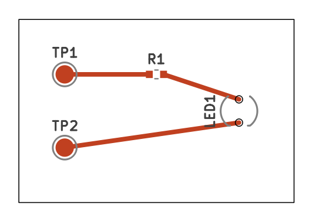

# librepcb-mcp

An MCP server that lets Claude Code, Codex, Cursor and other coding agents work on
[LibrePCB](https://librepcb.org) projects. Your agent can read a schematic, add parts from
the LibrePCB libraries, wire them, place and route the board, run ERC and DRC, and export
Gerbers. It runs on Linux over STDIO, with no Wine, Docker or web service.

<p>
  
  
</p>

The example above came from tool calls alone. LibrePCB 2.1.1 opens it in strict mode and
reports zero ERC and DRC messages.

## Install

```bash
curl -fsSL https://raw.githubusercontent.com/arcbaseproject/librepcb-mcp/main/install.sh | bash
```

The installer asks a few questions and then:

1. checks for Python 3.12+ and LibrePCB 2.x, and offers the Flathub package if LibrePCB is missing;
2. installs the server into `~/.local/share/librepcb-mcp`;
3. asks which folders the server may edit (default `~/pcb-projects`);
4. downloads the official LibrePCB libraries you pick;
5. registers the server with the agents it finds: Claude Code, Codex CLI, Gemini CLI, Cursor,
   Windsurf, VS Code and VSCodium.

It backs up each agent config before changing it. If it can't parse a config (VS Code allows
comments in JSON, for example), it leaves the file alone and prints the entry for you to paste.

| Command | Effect |
|---------|--------|
| `… \| bash` again | Update to the latest version |
| `… \| bash -s -- --yes` | Install with all defaults, no questions |
| `… \| bash -s -- --uninstall` | Remove the server and its agent entries; projects and libraries stay |

Restart your agent afterwards.

## Try it

Ask your agent things like:

- "Show me the components and nets of `~/pcb-projects/my-board`."
- "Change R1 to 470 Ω, run ERC and DRC, then export Gerbers."
- "Create a project in `~/pcb-projects/blinky`: a resistor and a green LED in series between
  VCC and GND, on a 25 × 15 mm board. Route it and check it."

Close a project in the LibrePCB app before your agent edits it. The server refuses to write
while LibrePCB holds the project's lock file.

## How edits stay safe

The server writes LibrePCB's own file format, in the exact byte layout LibrePCB produces.
For each edit it:

1. checks that LibrePCB doesn't have the project open and that no other program changed the files;
2. copies the project to `~/.local/state/librepcb-mcp/backups` (keeping the last 20 copies);
3. writes each changed file to a temporary file and renames it into place, so a crash can't
   leave half a file;
4. reopens the project with `librepcb-cli open-project --strict`;
5. restores every original file if LibrePCB rejects the result, and returns LibrePCB's error.

ERC, DRC and every export run through `librepcb-cli`. The server reports what LibrePCB says
and doesn't compute these results itself.

The server only touches folders listed in `LIBREPCB_MCP_ROOTS`. It resolves symlinks before
checking, and it never runs commands through a shell.

## Tools

All positions use millimeters and all angles degrees, counter-clockwise. LibrePCB's y axis
points up, and the schematic grid is 2.54 mm. You refer to things this way:

| Thing | Format | Example |
|-------|--------|---------|
| Component | designator or UUID | `R1` |
| Schematic pin | `DESIGNATOR:PIN`, with the pin or signal name | `U1:VCC`, `LED1:A` |
| Board pad | `DESIGNATOR:PAD` | `R1:1` |
| Via, trace corner | `via:<uuid>`, `junction:<uuid>` (returned by earlier calls) | |
| Schematic, board | name, UUID or index (default: the first) | `Main` |

**Projects**

| Tool | What it does |
|------|--------------|
| `server_status` | Shows allowed folders, the LibrePCB CLI and its version, libraries, backup folder |
| `create_project` | New project with a `Main` schematic, plus a board with a rectangular outline if you want one |
| `list_projects` | Finds `*.lpp` files inside the allowed folders |
| `get_project_info` | Metadata, pages, boards, counts, and whether LibrePCB has it open |
| `validate_project` | Strict open, then ERC and DRC |
| `backup_project` | Extra backup on request |

**Schematic**

| Tool | What it does |
|------|--------------|
| `list_schematics`, `inspect_schematic` | Pages; symbols and each wire and label per net |
| `list_components`, `get_component` | Parts; details include pin and pad positions and nets |
| `list_nets`, `get_net_connections` | Nets with their pins, labels, traces and vias |
| `create_schematic` | Adds a page |
| `add_component` | Adds a library part and places all its symbols |
| `remove_component` | Deletes a part with its wires and traces, and drops nets nothing uses anymore |
| `move_component` | Moves or rotates a symbol |
| `set_component_value` | Sets the value text and attributes such as `RESISTANCE` |
| `connect_pins` | Draws a wire between two pins on one page |
| `disconnect_pins` | Removes a pin's wires and detaches it from its net and traces |
| `create_net` | Creates a named net |
| `add_net_label` | Connects a pin to a net by name (`GND`, `VCC`), also across pages |

**Board**

| Tool | What it does |
|------|--------------|
| `list_boards`, `get_board_info` | Outline, placed and unplaced parts, unrouted connections per net |
| `create_board` | Adds a board |
| `add_device_to_board` | Places a part's footprint, on top or bottom |
| `place_component`, `rotate_component` | Moves, rotates or flips a placed part |
| `set_board_outline` | Sets a rectangle or polygon outline |
| `create_trace` | Draws a trace between pads, vias or trace corners of one net, with optional corner points |
| `create_via` | Adds a through via |
| `route_net` | Joins a net's pads with straight traces. It doesn't avoid obstacles, so run DRC afterwards |

**Checks and exports** (run by `librepcb-cli`)

| Tool | What it does |
|------|--------------|
| `run_erc`, `run_drc` | LibrePCB's checks, with each message and its severity |
| `export_schematic_pdf`, `export_board_pdf` | PDFs |
| `export_gerbers` | Gerber layers plus Excellon drill files |
| `export_bom` | Bill of materials (CSV) |
| `export_project` | Single-file `.lppz` archive |
| `run_output_jobs` | Runs the output jobs saved in the project |

Exports go to `<project>/output/mcp` unless you pass `output_dir`.

**Libraries**

| Tool | What it does |
|------|--------------|
| `list_libraries` | Installed libraries |
| `search_components` | Finds devices (a part plus its footprint) by keyword |
| `get_component_details`, `get_device_details`, `list_footprints` | Pins, pad mapping, footprints |

## Limitations

- `route_net` draws straight lines and won't avoid other copper. Expect DRC errors on busy boards.
- The server can't add copper planes or zones, rename or merge nets, draw buses, or add
  schematic graphics.
- You can't delete a single trace yet. `disconnect_pins` removes all traces on a pin.
- The server can't create library parts. The official libraries have no MX key switches or
  rotary encoder footprints, for example.
- `add_component` uses the first symbol variant, and the first footprint unless you name one.
- Parts get no manufacturer part number.
- The server doesn't edit `.lppz` archives.
- Projects older than LibrePCB 2.x need upgrading first:
  `librepcb-cli open-project --save project.lpp`.

Passing ERC and DRC doesn't make a board correct, safe or ready to order. Review the design
in LibrePCB before you send it to a fab.

## Manual setup

```bash
git clone https://github.com/arcbaseproject/librepcb-mcp.git
cd librepcb-mcp
python3 -m venv .venv
.venv/bin/pip install -e .
```

For Claude Code, put the server name before `-e`. `-e` takes several values and would
swallow the name otherwise:

```bash
claude mcp add librepcb --transport stdio -s user \
  -e LIBREPCB_MCP_ROOTS=$HOME/pcb-projects \
  -e LIBREPCB_MCP_LIBRARIES=$HOME/librepcb-libs \
  -- /absolute/path/to/librepcb-mcp/.venv/bin/python -m librepcb_mcp
```

Other clients: run `/absolute/path/to/.venv/bin/python -m librepcb_mcp` as a STDIO server with
the variables below.

| Variable | Meaning |
|----------|---------|
| `LIBREPCB_MCP_ROOTS` | Required. Folders the server may read and edit, separated by `:` |
| `LIBREPCB_MCP_LIBRARIES` | `*.lplib` folders or folders that contain them. Default: your LibrePCB workspace libraries |
| `LIBREPCB_CLI` | CLI command. Default: `librepcb-cli` on `PATH`, then the Flatpak |
| `LIBREPCB_MCP_BACKUP_DIR` | Backup folder. Default: `$XDG_STATE_HOME/librepcb-mcp/backups` |
| `LIBREPCB_MCP_CLI_TIMEOUT` | Seconds per CLI call. Default: 300 |
| `LIBREPCB_MCP_LOG` | Log level for stderr. Default: `WARNING` |

To get libraries without the installer:

```bash
git clone --depth 1 https://github.com/LibrePCB-Libraries/LibrePCB_Base.lplib ~/librepcb-libs/LibrePCB_Base.lplib
```

The LibrePCB Flatpak can only see your home folder, so keep projects and export folders there.

## Troubleshooting

| Message or symptom | Fix |
|--------------------|-----|
| `No project directories configured` | Set `LIBREPCB_MCP_ROOTS` |
| `outside the configured project roots` | Add the folder to `LIBREPCB_MCP_ROOTS` |
| `librepcb-cli not found` | Install LibrePCB 2.x or set `LIBREPCB_CLI`. Without it the server refuses edits |
| The CLI can't open files (Flatpak) | Move projects and outputs under `$HOME` |
| `Project is open in LibrePCB` | Close it in LibrePCB. After a crash, delete the stale `.lock` file |
| `Unsupported project file format` | Back up, then run `librepcb-cli open-project --save project.lpp` |
| `No libraries found` | Install libraries in LibrePCB or set `LIBREPCB_MCP_LIBRARIES` |
| `LibrePCB rejected the modified project` | Your files are unchanged. Please open an issue with the message |
| The agent doesn't list the tools | Run `claude mcp get librepcb`, or start the server command by hand with `LIBREPCB_MCP_LOG=DEBUG` |

## Development

```bash
.venv/bin/pip install -e '.[dev]'
.venv/bin/pytest
.venv/bin/pip install ruff && .venv/bin/ruff check src tests
```

The suite covers unit tests, real `librepcb-cli` runs and MCP protocol tests (in-process and
over STDIO). Tests that need `librepcb-cli` or `LibrePCB_Base.lplib` skip with a reason when
those are missing; `LIBREPCB_CLI` and `LIBREPCB_MCP_TEST_LIBRARY` point the tests at them. The
tests work under `~/.cache/librepcb-mcp-tests` so the Flatpak CLI can reach the files.

Tested on Void Linux (x86_64) with LibrePCB 2.1.1 (Flatpak), Python 3.14 and mcp 2.3.0.
[docs/architecture.md](docs/architecture.md) covers the file format research and the design.

## License

GPL-3.0-or-later. The example project includes parts from `LibrePCB_Base.lplib` (CC0-1.0)
and LibrePCB's `newstroke.bene` font.
